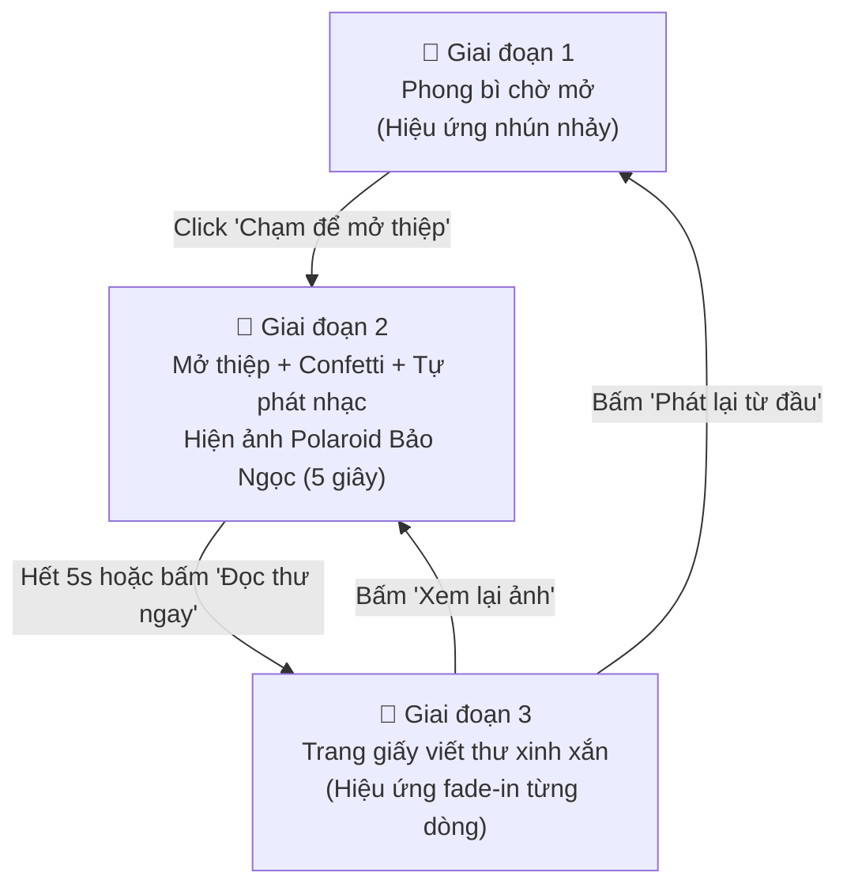

# 🎀 Kế Hoạch Xây Dựng Trang Web Sinh Nhật — Bảo Ngọc 16 Tuổi

---

## 1. Tổng quan dự án

| Hạng mục | Chi tiết |
|---|---|
| **Tên dự án** | Happy 16th Birthday – Bảo Ngọc |
| **Nền tảng** | Web tĩnh tách file: `index.html`, `style.css`, `script.js` |
| **Thư viện ngoài** | Google Fonts (CDN), `canvas-confetti` (CDN) |
| **Hỗ trợ thiết bị** | Mobile-first → Desktop (Responsive hoàn chỉnh) |
| **Thư mục lưu trữ** | `C:\Users\Admin\Documents\hpbd\` |

---

## 2. Kiến trúc 3 giai đoạn tương tác



---

## 3. Bảng màu & Typography (Design System)

### Bảng màu (Hài hòa, tôn vẻ nữ tính, trong sáng tuổi 16):
- **Nền chính:** Gradient hồng phấn nhạt (`#FFF5F7` chuyển nhẹ sang `#FFE4EC`).
- **Màu nhấn chính:** Hồng pastel (`#FF85A2`) và Hồng hoa hồng đào (`#FFB3C6`, `#E05A80`).
- **Màu chữ:** Nâu tím trầm (`#4A3740`), tương phản cao, êm mắt khi đọc trên nền sáng.
- **Khung thiệp & giấy thư:** Trắng tinh (`#FFFFFF`) kết hợp đổ bóng mềm viền hồng (`rgba(255,133,162,0.2)`).

### Typography:
- **Tiêu đề cảm xúc:** `Dancing Script` (Google Fonts).
- **Điểm nhấn/Tên:** `Pacifico` (Google Fonts).
- **Văn bản & Nút:** `Quicksand` (Google Fonts, hỗ trợ tiếng Việt mượt mà).

---

## 4. Cấu trúc thư mục tại `C:\Users\Admin\Documents\hpbd\`

```
C:\Users\Admin\Documents\hpbd\
│
├── index.html        # Khung giao diện HTML5, tích hợp các thẻ & chú thích thay ảnh/nhạc
├── style.css         # Toàn bộ định dạng giao diện, hiệu ứng chuyển động, responsive
├── script.js         # Toàn bộ logic tương tác 3 giai đoạn, countdown 5s, confetti, audio
└── ke-hoach.md       # Tài liệu kế hoạch chi tiết này
```

---

## 5. Hướng dẫn tùy chỉnh nhanh:
1. **Thay ảnh Bảo Ngọc:** Mở file `index.html`, tìm khối `📸 THAY LINK ẢNH CỦA BẢO NGỌC TẠI ĐÂY` và thay đổi đường dẫn `src`.
2. **Thay nhạc sinh nhật:** Mở file `index.html`, tìm khối `🎵 THAY LINK NHẠC SINH NHẬT TẠI ĐÂY` và điền link hoặc tên file `.mp3` đặt cùng thư mục.
